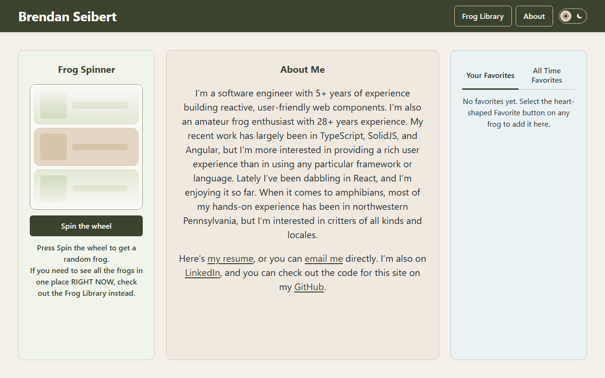
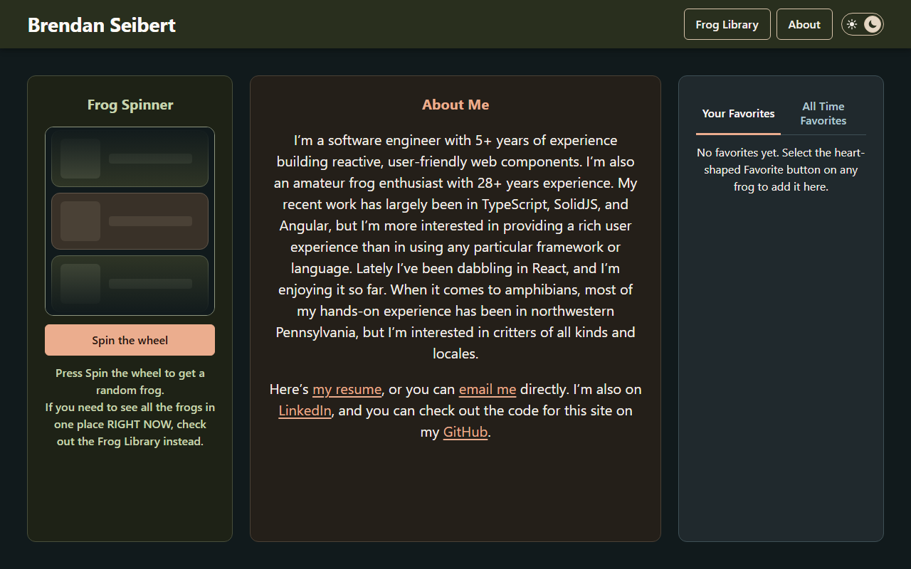
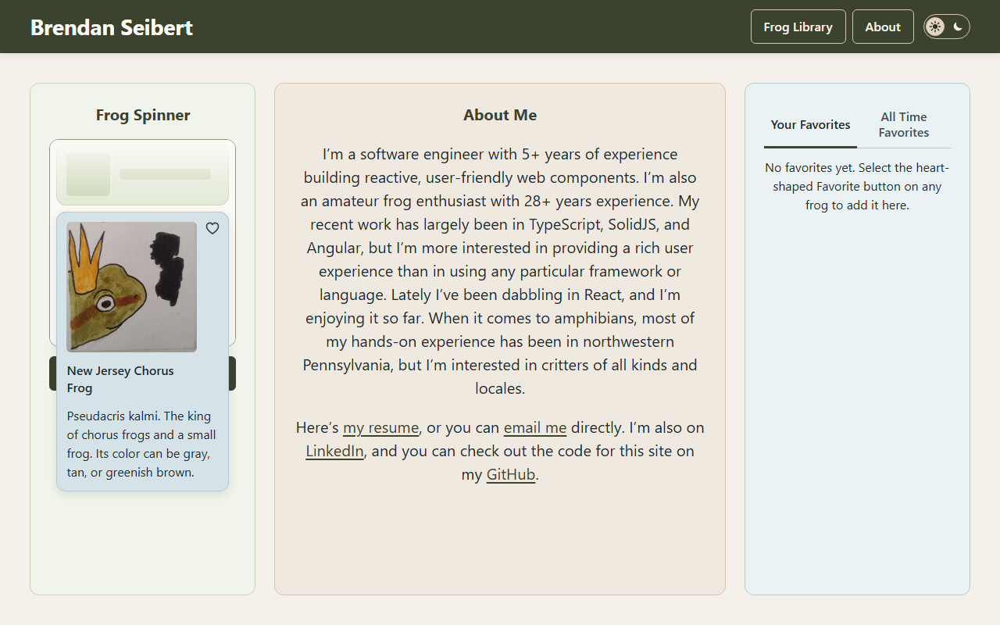
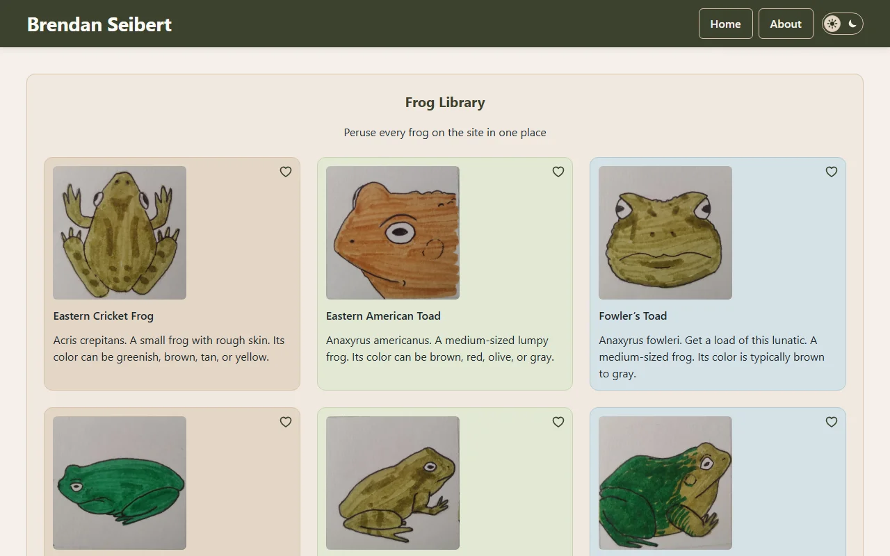
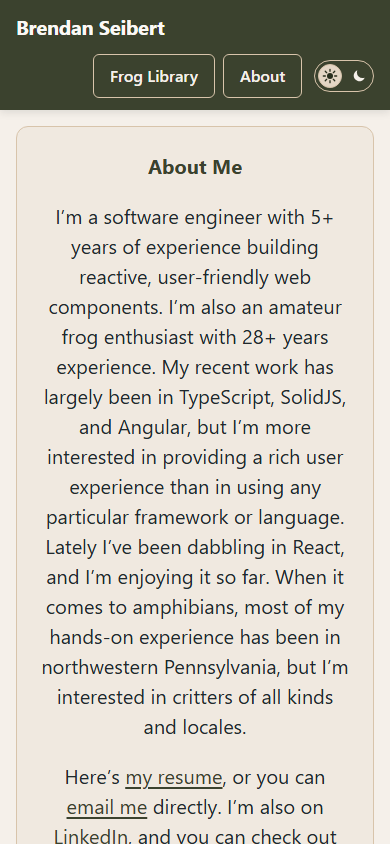
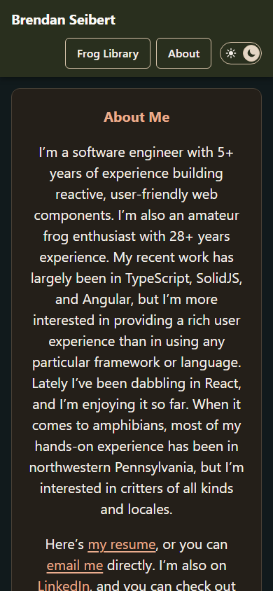

# Brendan Seibert · Personal Site

A personal site with a frog spinner, and an experiment in how far careful,
AI-assisted development can go. *(Codename EX3.)*

**Live at <https://graceful-learning-production-d3776046.up.railway.app/>** · [LinkedIn](https://www.linkedin.com/in/brendan-seibert)

<p>
  
  
</p>

## About this project

This is my corner of the web: a little bit about who I am, what I've worked on, and a lot of frogs. The
home page has a slot-machine-style **Frog Spinner** that lands on one of the frogs I've drawn,
the **Frog Library** shows every frog in one place all at once, and anyone can heart their favorite frogs without
signing up for anything.

<p>
  
  
</p>

It's also an exploration of building software with Claude. For this project I wanted to experiment more and lean in
further than before. Claude helped to plan features, orchestrate 
agents and review the code, with help from custom skills I wrote for those jobs. I set the
standards, made the calls and reviewed the changes before committing. The site is small,
but I held it to the bar I'd want from a production codebase.

## What's inside




- **Accessible by default.** WCAG 2.x AA throughout. Automated axe scans run on every page and key
  state at phone and laptop sizes, in both themes, plus WCAG 1.4.12 text-spacing checks. Every
  colour pairing's contrast is computed and tested, not eyeballed.
- **Dark mode done properly.** It follows your system setting until you choose, remembers your
  choice only in your browser (nothing is sent to the server), never flashes the wrong theme on
  load, and syncs across open tabs.
- **Favorites without accounts.** An anonymous, server-signed cookie. No IP addresses or user
  agents are stored. Clearing your cookies forgets you, but your likes stay in the all-time tally.
  The tally is for fun: anyone can clear their cookies and like again.
- **Hardened like it matters.** A strict Content Security Policy with no inline scripts, signed
  cookies, parameterised SQL, rate limits, a database connection that must use verified TLS or
  the host's private network, and a non-root production container. See the threat table under
  [Security](#security).
- **Tested at every layer.** Unit tests with a 90% coverage floor, integration tests against a
  real PostgreSQL, browser tests in real Chromium at nine viewport sizes, and a smoke test of the
  production image. All of it runs in CI on every push.
- **Conventions the tests enforce.** Colours live in one palette, every visible string goes
  through i18n, and each component's light and dark colours must match role for role. A test
  fails if any of these rules is broken.

<br clear="right">

## Built with Claude

I built the whole site with [Claude Code](https://claude.com/claude-code), in VS Code. These are
the techniques I used:

- **Several models, each where it fits.** Opus 5.5 and Fable 5.1 for planning, building and
  orchestrating, and Sonnet 5.5 as the parallel subagents that do broad review and implementation.
- **A project rulebook: [`CLAUDE.md`](CLAUDE.md).** It's loaded into every session. It holds
  the conventions, the deliberate exceptions ("this is below 3:1 on purpose, don't fix it"), the
  quirks of the dev environment, and the bar for calling work done. It's written for people as
  much as for Claude, and it changes whenever a session teaches me something.
- **Plans before code.** Every sizeable feature started as a plan document, 
  explaining the *how* and the *why* of each step. A fresh Claude session then checked
  the plan against the actual code and current library APIs before anything was built. Plans
  live outside the repo, so the codebase stays clean.
- **Orchestrated agent passes.** For a repo-wide quality pass, an Opus orchestrator splits the
  codebase into slices and fans out parallel Sonnet reviewer agents, each reading whole files
  through five lenses: idiomatic code, framework alignment, security, testability and comments.
  The orchestrator verifies every finding against the code itself before it reaches a plan. The
  fixes then ran as parallel agents in separate git worktrees, and each merge was reviewed before
  it landed.
- **Adversarial review.** Commits get a deliberately hostile review that looks for every way a
  change is wrong, fragile, insecure or hard to test. I leaned on fresh sessions with no stake in
  the code for review, rather than checking every line myself.
- **Guardrails that make AI output trustworthy.** The convention tests, coverage floors,
  accessibility scans, scripted contrast checks and CSP build check mean a change that breaks
  the house rules fails loudly, no matter who or what wrote it.
- **A human at the gate.** Claude never commits. I review and commit every change myself.
- **Building on the last project.** My previous Claude-assisted project served as a style guide,
  so this one started with a proven set of conventions instead of from scratch.

## Tech stack

- **Frontend:** React 19 + Vite 8, React Router 8, TanStack Query 5, Sass
- **Backend:** Node.js 24, Express 5, TypeScript, `pg`
- **Database:** PostgreSQL 16
- **Tests:** Vitest, Supertest, React Testing Library, MSW, Playwright (Chromium), axe-core
- **Running it:** Docker Compose in development; one Docker image in production, on Railway

## Getting started

Commands are written for a POSIX shell. On Windows, Git Bash or WSL works; PowerShell works for
everything except `scripts/*.sh`.

### Prerequisites

- Docker with Compose v2 (Docker Desktop or Docker Engine)
- Git
- Node.js 24 LTS, only needed to run the unit and browser tests outside Docker

### First-time setup

```sh
cp .env.example .env
```

The values in `.env.example` are for local development only. Keep the password to letters,
numbers, `-` and `_` (it goes inside a connection URL).

### Start everything

```sh
docker compose up --build
```

Then open <http://localhost:5173>. The API is also available directly at
<http://localhost:3000/api/health>. Add `-d` to run in the background.

### Stop everything

- `docker compose down` stops and removes the containers but keeps the database data.
- `docker compose down -v` also deletes the database volume (a full reset).

### Useful commands

| Command | What it does |
| --- | --- |
| `docker compose logs -f backend` | Watch the backend logs |
| `docker compose ps` | See the status of each service |
| `docker compose up --build backend` | Rebuild and restart one service |
| `docker compose up --build -V` | Rebuild after a `package.json` change (renews the containers' `node_modules`, keeps the database) |

## Running the tests

**Once, after cloning (and again whenever a `package-lock.json` changes),** install the packages
on your own machine. The unit tests run outside Docker, so they need their own copy:

```sh
cd backend
npm ci
cd ../frontend
npm ci
npx playwright install chromium
cd ..
```

Without this, `npm test` fails with "vitest: not found" or "Cannot find module". The
`playwright install` line downloads the Chromium build the browser tests drive (about 150 MB,
once per machine); npm does not do this for you.

**Backend unit tests** (type check, then tests with a 90% coverage threshold):

```sh
cd backend
npm test
```

**Frontend unit tests** (same idea):

```sh
cd frontend
npm test
```

**Frontend browser tests** (headless Chromium, on your machine rather than in Docker):

```sh
cd frontend
npm run test:browser
```

They cover layout at nine viewport sizes from phone to wide desktop, focus and keyboard
behaviour, both themes, and [axe-core](https://github.com/dequelabs/axe-core) WCAG 2.x A and AA
scans of every page and key state. They include real frog-spinner spins (3 seconds each), so the
run takes a couple of minutes. axe finds only mechanical failures; it doesn't replace checking by
hand with a screen reader, the keyboard, zoom and a contrast theme.

**Backend integration tests** (real PostgreSQL in a throwaway Docker stack; no local install
needed). Run both commands; the second always cleans up:

```sh
docker compose -p ex3-test -f docker-compose.test.yml up --build --abort-on-container-exit --exit-code-from backend-tests
docker compose -p ex3-test -f docker-compose.test.yml down -v
```

The first command's exit code is the test result (0 = passed).

## Configuration

`.env` (copied from `.env.example`) holds the database name, user and password, the backend
port, and:

- **`COOKIE_SECURE`** (`true` or `false`, default `false`): the visitor cookie's `Secure` flag. Keep `false` for `http://localhost`. It **must be `true`** on any server reached over HTTPS, so the cookie is never sent over plain HTTP. Any other value stops the backend at startup. `true` also turns on HSTS.
- **`NODE_ENV`** (`development`, `test` or `production`, default `development`): `production` refuses `COOKIE_SECURE=false`, a missing `VISITOR_SECRET` and a database connection without TLS (unless `DATABASE_PRIVATE_NETWORK=true`), and turns on the rate limits and the `Origin` check. The production image sets it; development never does.
- **`TRUST_PROXY`** (a hop count, default `0`): how many reverse proxies sit in front of the backend. `0` locally, usually `1` behind one proxy, never `true` (refused at startup). Check it on the host with the steps in [Security](#security).
- **`STATIC_DIR`**: the folder with the built frontend. Only the production image sets it (`/app/public`); unset, the backend serves no files.
- **`VISITOR_SECRET`**: the key that signs the visitor cookie. **Required in production**: at least 32 random characters, for example from `openssl rand -base64 48`, kept in the host's dashboard. Unset elsewhere, a fixed development key is used (production refuses it). Changing it makes every existing visitor a new one: their likes stay in the tally, but Your Favorites starts empty.
- **`DATABASE_URL`** on a host: `?sslmode=verify-full`, or no `sslmode` on the host's private network (with `DATABASE_PRIVATE_NETWORK=true`). `require`, `prefer`, `verify-ca`, `no-verify`, `disable`, the `ssl` parameter, `uselibpqcompat` and any TLS parameter given twice stop the backend at startup (the error never prints the URL).
- **`DATABASE_CA_CERT`**: the PEM text of a database provider's own root certificate, for providers not signed by a public authority. The URL must then carry no `sslmode` or other `ssl…` parameter. Line breaks stored as a literal `\n` are turned back into real ones.
- **`DATABASE_PRIVATE_NETWORK`** (`true` or `false`, default `false`): `true` only when the database is reached over the host's private network (Railway's `*.railway.internal`, Render's internal URL, the self-hosted Compose network). It is the only way production starts without TLS to the database, so a public URL that lost its `?sslmode=verify-full` fails loudly instead of running in plain text.

## Production

### Where it runs

The live site is <https://graceful-learning-production-d3776046.up.railway.app/>, on
[Railway](https://railway.com). Every push to `main` that passes CI is built from the root
`Dockerfile` and deployed automatically. The database is Railway's managed PostgreSQL, reached
over Railway's private network (`DATABASE_PRIVATE_NETWORK=true`). Run-time variables are set in
the app service's **Variables** tab: `DATABASE_URL` (a reference to the Postgres service),
`DATABASE_PRIVATE_NETWORK`, `COOKIE_SECURE=true`, `TRUST_PROXY=1`, `VISITOR_SECRET` and
`PORT=3000`.

**Known issue:** behind Railway, the rate limits currently key on Railway's own addresses rather
than the visitor's, so all visitors share a couple of buckets. Railway's edge overwrites
`X-Forwarded-For`, so no `TRUST_PROXY` value fixes it; the fix (keying on Railway's `X-Real-IP`)
needs a code change. The key check under [Security](#security) shows it.

### The image

One container serves the built React app and the API on one port, in front of a managed
PostgreSQL. Build it from the repository root:

```sh
docker build -t ex3 .
```

- **What's in the image** (`Dockerfile`, three stages): `node:24-alpine`, the compiled backend (`dist/`), the migrations, the frontend build (`public/`) and production packages only. It runs as the `node` user, with `NODE_ENV=production` and `STATIC_DIR=/app/public`. No source, dev packages, `.env` or `*.md` (see `.dockerignore`).
- **Run-time settings** come from the host, never the image: `DATABASE_URL`, `COOKIE_SECURE=true`, `VISITOR_SECRET`, `TRUST_PROXY`, `PORT` (default 3000) and, if used, `DATABASE_CA_CERT` or `DATABASE_PRIVATE_NETWORK=true`.
- **Smoke test** (any POSIX shell, with Docker running): `sh scripts/smoke.sh` builds the image, runs it against a throwaway PostgreSQL and checks the headers, caching, 404s, the `Origin` check, the new-visitor limit and the `node` user. It prints `smoke ok`.
- **Self-hosting (optional):** `docker-compose.prod.yml` runs the image (read-only, no Linux capabilities), PostgreSQL (no published port) and Caddy (automatic HTTPS, only ports 80 and 443). Put real `POSTGRES_*` values (a password of letters and digits only, such as `openssl rand -hex 24`, because it goes into a URL), `VISITOR_SECRET` and `SITE_ADDRESS` in `.env`, then `docker compose -f docker-compose.prod.yml up -d --build`. Backups are yours: a nightly `pg_dump` copied off the machine.

## Security

| Threat | What stops it |
| --- | --- |
| Injected scripts (XSS) | React escapes text; a strict CSP (`default-src 'none'`, `'self'` only, no `'unsafe-inline'`). `scripts/check-dist.sh` fails the build on an inline script or style |
| Clickjacking | `frame-ancestors 'none'`, `X-Frame-Options` |
| HTTP downgrade | HSTS (`max-age=86400` to start; raise to `31536000` after a week of HTTPS), `Secure` cookie, production refuses `COOKIE_SECURE=false` |
| Cross-site likes (CSRF) | `SameSite=Lax`, no CORS headers, `PUT`/`DELETE` with a foreign `Origin` answer `403` (production) |
| Floods | Per address, in production: 600 API requests and 60 likes/unlikes per 15 minutes; 10 KB bodies; database timeouts |
| Ballot stuffing from one address | The visitor cookie is signed, so made-up IDs count as new visitors; 30 new visitors per address per hour |
| Forged `X-Forwarded-For` | `TRUST_PROXY` is a hop count, never `true` |
| Path traversal, dotfiles, secrets in the image | `express.static` containment, `dotfiles: 'ignore'`; the image holds no source or `.env` |
| Container escalation | Runs as `node`; on the self-hosted stack, read-only, no capabilities, `no-new-privileges` |
| Vulnerable packages | `npm audit` in CI, Dependabot weekly |
| Database eavesdropping or impersonation | `sslmode=verify-full` or `DATABASE_CA_CERT` (certificate and hostname verified), or the host's private network (`DATABASE_PRIVATE_NETWORK=true`); production refuses plain text otherwise; weak, repeated or conflicting TLS parameters refused at startup |
| Fingerprinting | No `X-Powered-By`, generic errors, no source maps |
| Shared caches leaking favorites | `no-store` on all of `/api` |

**Not prevented, by design:** ballot stuffing from many addresses (about 720 new visitors a day
each), and a volumetric denial of service beyond one small container (put Cloudflare's free tier
in front if it matters).

**Check the headers** once hosted with securityheaders.com (expect A or better) and Mozilla's
HTTP Observatory (one step lower until HSTS is raised to a year).

**Check the host** after the first deploy and after any hosting change:

1. Writes from other sites are refused (prints `403`):

   ```sh
   site="https://<your-site>"
   curl -s -o /dev/null -w '%{http_code}\n' -X PUT -H "Origin: https://evil.example" "$site/api/favorites/entry01"
   ```

2. The rate limiter keys on *your* address, and a forged one isn't believed. This is read-only:
   it uses about 10 of the 600 reads per 15 minutes and changes nothing. It reads the
   `RateLimit-Policy` header, whose `pk=:…:` is the base64 of the first 12 hex characters of the
   SHA-256 of the address the app keyed on. (That's express-rate-limit 8's format, so recheck this
   after a major version bump. On macOS, use `shasum -a 256` for `sha256sum`.)

   ```sh
   ip=$(curl -4 -s https://api.ipify.org)              # your public IPv4
   mine=$(printf '%s' "$ip" | sha256sum | cut -c1-12)
   for i in $(seq 1 10); do
     pk=$(curl -4 -s -D - -o /dev/null -H "X-Forwarded-For: 192.0.2.$i" "$site/api/favorites/top" \
       | grep -i -o 'pk=:[^:]*:' | cut -d: -f2 | base64 -d)
     [ "$pk" = "$mine" ] && echo ok || echo "MISMATCH $pk"
   done
   ```

   Every line must be `ok`. If the mismatches repeat as the same few values, the app is keying on
   the host's proxies (`TRUST_PROXY` too low): raise it by one and redeploy. If they are all
   different, it believes the forged header (`TRUST_PROXY` too high): lower it by one.

## CI

`.github/workflows/ci.yml` runs on every push and pull request, with read-only permissions:

| Job | What it runs |
| --- | --- |
| `backend` | `npm ci`, `npm audit --omit=dev --audit-level=high`, `npm test`, `npm run build` |
| `frontend` | the same, plus lint, the browser tests, `scripts/check-dist.test.sh` and `scripts/check-dist.sh` |
| `integration` | the integration test stack |
| `image` | `scripts/smoke.sh` |

A high or critical vulnerability in a shipped package fails the build. Dependabot
(`.github/dependabot.yml`) opens weekly pull requests for npm, Docker and GitHub Actions updates.
**A red check blocks the deploy: Railway waits for CI.** On GitHub, also turn on Dependabot
alerts, secret scanning, and a branch protection rule on `main` requiring the four jobs.

## Architecture

In development, Vite serves the React app and forwards `/api` to the backend:

```text
Browser (React) --> Vite dev server --/api--> Node + Express --SQL--> PostgreSQL
                    (frontend container)      (backend container)     (db container)
```

In production there is no Vite: one container answers everything.

```text
                 HTTPS                      private network (TLS or the host's own network)
 Browser  ───────────────▶  Host's proxy  ───▶  Container (node, non-root)  ───▶  Managed PostgreSQL
                            TLS ends here       Express:
                                                  helmet ▸ compression ▸ rate limits ▸ Origin check
                                                  /assets/*  → 1-year immutable cache
                                                  /api/*     → JSON, no-store
                                                  any GET    → index.html (no-cache) → React Router
```

The file-by-file map is in [`CLAUDE.md` § Project map](CLAUDE.md#project-map).

## Contributing

The project's conventions live in [`CLAUDE.md`](CLAUDE.md). It's the rulebook for human and AI
contributors alike, and the tests enforce most of it. Before changing code, read the section for
the area you're touching:

- [Frontend conventions](CLAUDE.md#frontend-conventions-enforced-by-tests): colours, sizes, text, class names, styles
- [Colour](CLAUDE.md#colour) and [Accessibility](CLAUDE.md#accessibility-wcag-2x-aa): new colours need AA pairings in `contrast.test.ts`, and new pages or states need an axe case
- [Pages and navigation](CLAUDE.md#pages-and-navigation): the checklist for a new page
- [Frogs](CLAUDE.md#frogs-spinner-entries): adding or removing a frog (text, image, migration)
- [Favorites](CLAUDE.md#favorites): how visitors are remembered and what is stored
- [Backend and database](CLAUDE.md#backend-and-database): migrations are append-only
- [Security](CLAUDE.md#security-keep-intact): what must stay intact

The workflow: for anything bigger than a small fix, write a plan first (see
[Built with Claude](#built-with-claude)). Run the full suite before opening a pull request:
backend and frontend unit tests, browser tests, integration tests, and the smoke test when the
image or backend changed. CI runs the same jobs, and a red check blocks the deploy.

## Troubleshooting

### Local development

- **Port already in use:** stop whatever uses 5173, 3000 or 5432, or change *your* side of the `ports:` mapping in `docker-compose.yml` (the middle number in `"127.0.0.1:5173:5173"`). Keep the `127.0.0.1:` at the front.
- **"password authentication failed" although `.env` is correct:** another PostgreSQL is probably already listening on port 5432 and answering instead of the Docker one. Stop it, or map the Docker database to `"127.0.0.1:5433:5432"` and connect on 5433.
- **Backend logs show "host not found", "getaddrinfo ENOTFOUND" or "Invalid URL" right after you changed the password:** the password contains a character that breaks the URL (`@ : / # ? %`). Use only letters, numbers, `-` and `_`, then run `docker compose down -v` (see below).
- **The app works on your machine but not from your phone or another computer:** this is intentional. All ports are bound to `127.0.0.1` so the dev servers are not reachable from the network.
- **Page loads but says "Favorites are unavailable right now.":** run `docker compose logs backend`. Open <http://localhost:3000/api/health>; if the database is down, the backend logs the real reason on a line starting with `Health check: database query failed`.
- **Compose stops with "Copy .env.example to .env first":** you have no `.env` file. Run `cp .env.example .env`.
- **After a `package.json` change, or `Cannot find package …` in development:** run `docker compose up --build -V`. It renews the containers' `node_modules` volume and keeps your database. Only use `docker compose down -v` if you also want to wipe the database.
- **Database container never becomes healthy after changing `POSTGRES_USER`, `POSTGRES_PASSWORD` or `POSTGRES_DB`:** those values are applied only when the data volume is first created. Run `docker compose down -v` to reset it.
- **`npm run test:browser` fails with "browserType.launch: Executable doesn't exist":** run `npx playwright install chromium` in `frontend`.

### On a host

- **`Invalid environment variables: COOKIE_SECURE: must be "true" in production`:** set `COOKIE_SECURE=true` on the host.
- **`self-signed certificate` or `Hostname/IP does not match` from `pg`:** the URL's host is wrong, or the provider needs `DATABASE_CA_CERT`. Never disable verification.
- **`sslmode=require is not allowed`:** use `sslmode=verify-full`, or `DATABASE_CA_CERT` with no `sslmode`.
- **`DATABASE_URL: needs TLS in production`:** add `?sslmode=verify-full`, or set `DATABASE_CA_CERT`. Only if the database is on the host's private network, set `DATABASE_PRIVATE_NETWORK=true` instead.
- **`VISITOR_SECRET: must be set to your own random value in production`:** set it on the host to the output of `openssl rand -base64 48`, and keep it: changing it starts every visitor's favorites over.
- **Likes fail with `403 Forbidden` on the host:** something in front rewrites the `Host` header; check the proxy setup.
- **Every visitor gets `429` at once:** the rate limiter isn't keying on visitors' own addresses; run the key check in [Security](#security).
- **A page shows but a hard refresh 404s:** `STATIC_DIR` is unset or wrong.

## Colour

The palette is in `frontend/src/styles/_palette.scss`. The rules behind these colours are in
[`CLAUDE.md` § Colour](CLAUDE.md#colour). Every row below is checked by
`frontend/src/styles/contrast.test.ts`. A new pairing goes in both places.

Light pairings (`LIGHT_PAIRINGS`). Text needs 4.5:1; rows marked "needs 3" are non-text:

| Where | Foreground on background | Contrast |
| --- | --- | --- |
| Body text on the page, the columns and the cards | `sky-900` on `sand-100`, `sand-150`, `sage-100`, `sky-100`, `sand-200`, `sage-200`, `sky-200` | 10.4 to 13.3 |
| Column headings (middle, left, right; the Frog Library and About headings match the middle) | `sage-800` on `sand-150`, `sage-800` on `sage-100`, `sky-800` on `sky-100` | 8.7, 9.4, 9.9 |
| Page-not-found heading | `sage-800` on `sand-100` | 9.2 |
| Spinner status line | `sage-800` on `sage-100` | 9.4 |
| Links in the About Me section, and on hover | `sage-800` on `sand-150`, `sage-900` on `sand-150` | 8.7, 11.5 |
| Nav bar title and buttons | `sand-50` and `sand-100` on `sage-800` | 10.0, 9.2 |
| Nav button on hover | `sage-900` on `sand-200` | 9.7 |
| "Spin the wheel" button, and on hover | `sand-50` on `sage-800`, on `sage-900` | 10.0, 13.1 |
| "Spin the wheel" button outline against its column | `sage-800` on `sage-100` | 9.4 (needs 3) |
| Nav button outline and focus ring | `sand-300` on `sage-800` | 6.2 (needs 3) |
| Page focus ring | `sky-700` on any page or column surface | 7.0 or more (needs 3) |
| Payline | `sage-800` on `sand-50` | 10.0 (needs 3) |
| Favorite heart (outline and fill) | `sage-800` on the card tones `sand-200`, `sage-200`, `sky-200` | 7.3, 8.3, 7.9 (needs 3) |
| Favorites tabs: text, and on hover | `sky-700` on `sky-100`, on `sky-200` | 7.5, 6.4 |
| Favorites tabs: selected text | `sky-900` on `sky-100` | 13.1 |
| Favorites tabs: the selected tab's bar | `sage-800` on `sky-100` | 9.2 (needs 3) |
| Heart focus ring on the card tones | `sky-700` on `sand-200`, `sage-200`, `sky-200` | 5.9, 6.7, 6.4 (needs 3) |
| Heart on its hover surface | `sage-800` on `sand-50` | 10.0 (needs 3) |
| Card focus ring on the spinner window | `sky-700` on `sand-50` | 8.0 (needs 3) |

### Dark mode

Dark pairings (`DARK_PAIRINGS`):

| Where | Foreground on background | Contrast |
| --- | --- | --- |
| Body text on the page | `sand-100` on `sky-950` | 15.60 |
| Body text on the middle, left, right column | `sand-100` on `sand-900`, `sage-950`, `sky-900` | 14.42, 14.31, 13.08 |
| Body text on sand, sage, sky cards | `sand-100` on `sand-800`, `sage-850`, `sky-850` | 11.27, 11.02, 11.64 |
| Middle heading (and Frog Library, About) | `sienna-300` on `sand-900` | 8.48 |
| Left heading, spinner result line | `sage-300` on `sage-950` | 10.40 |
| Right heading | `sky-300` on `sky-900` | 8.65 |
| Not-found and error headings | `sienna-300` on `sky-950` | 9.17 |
| Link in the middle column, and on hover | `sienna-300`, `sienna-200` on `sand-900` | 8.48, 11.31 |
| Nav title, nav links | `sand-50`, `sand-100` on `sage-900` | 13.15, 12.20 |
| Nav link on hover | `sage-900` on `sand-200` | 9.69 |
| Nav outline and focus ring | `sand-300` on `sage-900` | 8.16 (needs 3) |
| "Spin the wheel" button, and on hover | `sienna-950` on `sienna-300`, on `sienna-200` | 9.09, 12.11 |
| "Spin the wheel" button against its column | `sienna-300` on `sage-950` | 8.41 (needs 3) |
| Page focus ring on page, middle, left, right | `sky-300` on `sky-950`, `sand-900`, `sage-950`, `sky-900` | 10.32, 9.54, 9.46, 8.65 (needs 3) |
| Payline | `sienna-400` on `sky-950` | 6.58 (needs 3) |
| Heart on sand, sage, sky cards | `sienna-300` on `sand-800`, `sage-850`, `sky-850` | 6.63, 6.48, 6.85 (needs 3) |
| Heart on its hover surface | `sienna-300` on `sky-950` | 9.17 (needs 3) |
| Heart focus ring on sand, sage, sky cards | `sky-300` on `sand-800`, `sage-850`, `sky-850` | 7.46, 7.29, 7.70 (needs 3) |
| Favorites tabs: text, and on hover | `sky-300` on `sky-900`, on `sky-800` | 8.65, 6.57 |
| Favorites tabs: selected text | `sand-50` on `sky-900` | 14.11 |
| Favorites tabs: the selected tab's bar | `sienna-300` on `sky-900` | 7.70 (needs 3) |
| Card focus ring on the spinner window | `sky-300` on `sky-950` | 10.32 (needs 3) |

The switch (`TOGGLE_PAIRINGS`) is checked on both nav bar colours (`sage-800` in light,
`sage-900` in dark); every row needs 3:

| Where | Foreground on background | Light | Dark |
| --- | --- | --- | --- |
| Switch track outline | `sand-300` on the nav bar | 6.19 | 8.16 |
| Switch track outline on hover | `sand-50` on the nav bar | 10.0 | 13.15 |
| Inactive icon | `sand-100` on the nav bar | 9.25 | 12.20 |
| Thumb against the track | `sand-200` on the nav bar | 7.34 | 9.69 |
| Active icon on the thumb | `sage-900` on `sand-200` | 9.69 | 9.69 |

In dark mode, these are below 3:1 on purpose and aren't tested: card against panel (about
1.3:1), panel borders (1.6 to 1.9:1), concealed reel shapes against their card (decoration with
no text) and the column against the page (about 1.1:1). The spinner window's border (`sage-500`
on `sky-950`) is 5.67.
